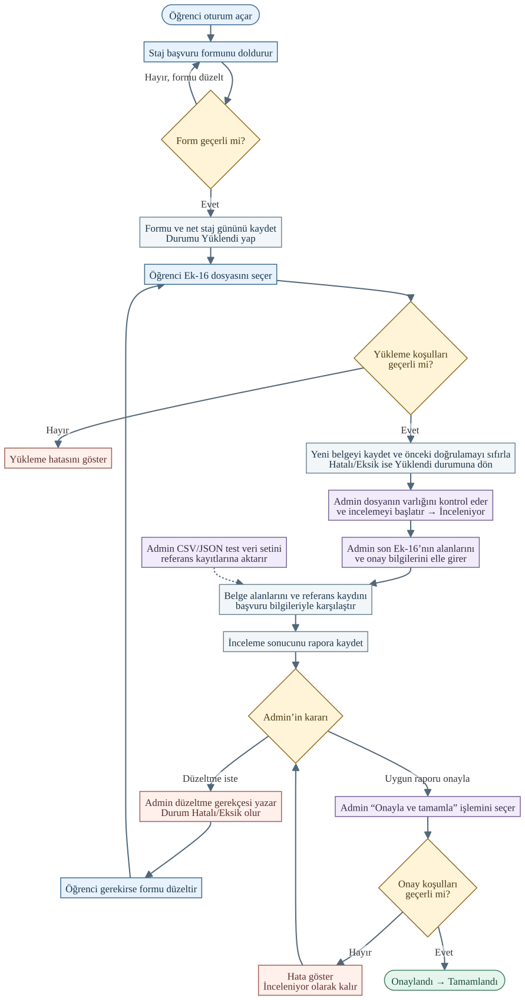

# Ek-16 başvuru akışı ve kaba kod

**DOC-1 · Mehmet Erkun**

**İncelenen kod sürümü** `a609b90`

## Akış diyagramı



Öğrenci hesabını kendi şifresiyle oluşturabilir. Admin’in CSV veya JSON aktarımı, karşılaştırmada kullanılan referans kayıtlarını oluşturur. Kesikli ok bu veri girişini gösterir.

Başvuru formu kaydedildiğinde başvuru `Yüklendi` durumunu alır. Admin’in inceleme başlatabilmesi için dosyanın da yüklenmiş olması gerekir. Yükleme denetimi sahipliği, statüyü, dosya boyutunu, uzantıyı, dosya biçimini ve tarih koşullarını kapsar. Öğrenci kendi başvurusunun raporunu görebilir.

## Kaba kod

### Başvuru oluşturma ve net staj günü hesabı

```text
Öğrenci oturumunu doğrula.
Başvuru formunu oku.
Zorunlu alanları, iletişim biçimlerini, mühendis sayısını ve tarih aralığını denetle.
Haftalık çalışma günü seçimini ve varsa Google Form bağlantısını denetle.
Hata varsa formu hatalarla birlikte yeniden göster ve işlemi bitir.

Net gün = 0
Başlangıç ve bitiş tarihleri dahil her tarih için:
    Tarihin haftanın günü seçilen günler arasındaysa:
        Tatil payı = bu tarihte tam gün için 1, yarım gün için 0,5, diğer günler için 0
        Net gün = net gün + 1 − tatil payı

Formu, öğrenci hesabının ID’sini ve net günü Internships tablosuna kaydet.
// Belge daha yüklenmeden başvuru Yüklendi durumunu alır.
Başvuru durumunu Yüklendi olarak başlat.
Başvuru ayrıntılarını ve Ek-16 yükleme formunu göster.
```

### Ek-16 yükleme ve yeniden yükleme

```text
Başvuruyu getir. Öğrenci rolünü ve başvurunun öğrenciye ait olduğunu doğrula.
Başvuru Yüklendi veya Hatalı/Eksik durumunda değilse yüklemeyi engelle.
Dosya boşsa veya 10 MB sınırını aşıyorsa hata göster ve işlemi bitir.
Uzantı .doc, .docx, .pdf, .jpg, .jpeg veya .png dışında ise işlemi reddet.

Yükleme zamanını al ve Türkiye takvim tarihine dönüştür.
Başvurunun tarihlerini ve staj başlangıcına en az 30 takvim günü kaldığını denetle.
Dosya biçimini uzantısına göre doğrula.
DOCX için Word paketinin gerekli girdilerini de denetle.
Kontrollerden biri başarısızsa hata göster ve işlemi bitir.

Dosyayı başvuruya ait depolama klasörüne kopyala.
Veritabanı işlemi başlat.
    Güncel başvuru tarihlerini tekrar denetle.
    Dosya yolunu, türünü ve yükleme zamanını Documents tablosuna yaz.
    // Belge değişince önceki karşılaştırma sonucu yeniden kullanılamaz.
    Başvurunun önceki Ek-16 doğrulamasını sıfırla.
Veritabanı işlemini kaydet.
Kayıt başarısızsa kopyalanan dosyayı sil ve hatayı bildir.

Başvurunun durumu Hatalı/Eksik ise Yüklendi durumuna dön ve geçişi kaydet.
Yükleme sonucunu öğrenciye göster.
```

### Admin incelemesi ve alan karşılaştırması

```text
Admin test veri seti yüklerse:
    CSV veya JSON içindeki satırları doğrula.
    Geçerli ve tekrar etmeyen kayıtları OfficialStudentRecords tablosuna ekle.
    Eklenen, tekrarlanan ve hatalı kayıtları Admin’e göster.

Admin incelemeyi başlatmak isterse:
    Başvuru Yüklendi durumunda ve dosya mevcut ise:
        Başvuruyu İnceleniyor durumuna geçir ve geçişi kaydet.

Admin incelemeyi kaydederse:
    Admin rolünü, İnceleniyor durumunu ve seçilen belgenin son Ek-16 olduğunu doğrula.
    Belge alanlarını ve onay bilgilerini Admin’in girdiği formdan al.
    // Referans kayıt başvuru sahibine göre seçilir.
    Başvuru sahibinin öğrenci numarası veya kimlik numarasıyla referans kaydı ara.
    Her adaya öğrenci numarası eşleşmesi için 4, kimlik eşleşmesi için 4,
    öğretim yılı eşleşmesi için 2 puan ver. En yüksek puanlı kaydı seç.
    Eşitlikte veritabanındaki ID’si küçük olan kaydı seç.

    Başvuru ve hesap bilgilerini bulunan referans kayıtla karşılaştır.
    Kayıt yoksa bunu uyuşmazlık olarak kaydet.
    Başvuru ve hesap bilgilerini Admin’in girdiği belge değerleriyle karşılaştır:
        Öğrenci numarası, kimlik numarası, ad soyad, bölüm ve öğretim yılı
        Başlangıç ve bitiş tarihleri, hesaplanan net gün
        İletişim bilgileri, yarıyıl ve işyeri adı
        Girilmişse belgeye ait çalışma günleri, beyan edilen net gün ve mühendis sayısı
    Uyuşmazlıkları birleştir. Referans bulunduysa ve uyuşmazlık yoksa doğrulamayı kaydet.
    Aksi halde önceki doğrulama işaretlerini sıfırla.
    Mühendis sayısı 1’den küçükse inceleme sonucuna hata ekle.
    Öğrenci ve danışman onay alanlarının boş olduğunu doğrula.
    İşveren bölümünün dolu olduğunu, kaşe ve imzanın bulunduğunu doğrula.
    İncelenmemiş veya beklenen duruma uymayan onay alanlarını hata olarak ekle.
    Son belgeye inceleyen Admin’i, zamanı, onay alanlarını ve varsa hataları kaydet.
    // İnceleme sonucu kaydedilince başvuru İnceleniyor durumunda kalır.
    Raporu göster.
```

### Düzeltme isteği ve tamamlama

```text
Admin Düzeltme iste işlemini seçerse:
    Boş olmayan, en fazla 500 karakterlik bir gerekçe al.
    İnceleniyor → Hatalı/Eksik geçişini kaydet.
    Öğrenci gerekirse formu günceller ve yeni Ek-16 yükler.
    Yükleme başarılıysa Hatalı/Eksik → Yüklendi olur ve yeni inceleme başlayabilir.

İnceleme kaydı varsa, raporda hata yoksa ve Ek-16 doğrulandıysa:
    Admin’e Onayla ve tamamla işlemini sun.
    Admin onaylarsa:
        // Onaylandı ve Tamamlandı geçişleri birlikte kaydedilir.
        Tek veritabanı işlemi başlat.
        Onaylandı ve Tamamlandı hedeflerinin her biri için:
            Admin yetkisini, izin verilen geçişi ve son belgenin onay koşullarını denetle.
            Kontrol başarısızsa işlemi geri al, hatayı göster ve bitir.
            Başvurunun durumunu güncelle, son Ek-16’yı onayla ve geçişi kaydet.
        Veritabanı işlemini kaydet.
        Başvuruyu Admin’in Tamamlandı sekmesinde göster.
        Öğrencinin düzenleme, silme ve yeniden yükleme işlemlerini engelle.
```

## Vize açıklamasına göre uygulamadaki farklar

| Beklenen davranış | `a609b90` sürümündeki davranış |
| --- | --- |
| Öğrencinin manuel bilgileri saklanır. Ek-16 alanları otomatik okunur ve kayıtla karşılaştırılır. | Manuel form saklanır. Karşılaştırmanın belge tarafını Admin elle girer. Otomatik alan okuma eksiktir. |
| Vizede yüklemeye bağlı kontroller dosya formatı ve uzantısını kapsar. | Yükleme ayrıca akademik tarih ve en az 30 gün önce teslim koşulunu uygular. |
| Öğrenci `Tamamlandı` belgesini düzenleyemez veya silemez. Bu işlemler Admin’e açıktır. | Öğrenciye uygulanan engel var. Servis katmanında Admin’e değişiklik ve silme yetkisi tanımlı. Admin ekranında tamamlanmış belgeyi düzenleme veya silme işlemi eksik. |

## Kod kaynakları

- [Başvuru ve net gün hesabı](https://github.com/mehmetcnozb/Staj_Evrak_Sistemi/blob/a609b9046f149c2c61c766d972c83a7b1bb0bf07/StajEvrakSistemi/Services/InternshipService.cs#L38-L75) · [Tatil payı ve gün hesabı](https://github.com/mehmetcnozb/Staj_Evrak_Sistemi/blob/a609b9046f149c2c61c766d972c83a7b1bb0bf07/StajEvrakSistemi/Core/InternshipDayCalculator.cs#L6-L45)
- [Yükleme arayüzü](https://github.com/mehmetcnozb/Staj_Evrak_Sistemi/blob/a609b9046f149c2c61c766d972c83a7b1bb0bf07/StajEvrakSistemi/Controllers/StudentController.Upload.cs#L12-L85) · [Dosya kaydı ve tarih denetimi](https://github.com/mehmetcnozb/Staj_Evrak_Sistemi/blob/a609b9046f149c2c61c766d972c83a7b1bb0bf07/StajEvrakSistemi/Services/DocumentService.cs#L40-L98)
- [Test veri seti aktarımı](https://github.com/mehmetcnozb/Staj_Evrak_Sistemi/blob/a609b9046f149c2c61c766d972c83a7b1bb0bf07/StajEvrakSistemi/Services/DatasetImportService.cs#L103-L188) · [Manuel inceleme formu](https://github.com/mehmetcnozb/Staj_Evrak_Sistemi/blob/a609b9046f149c2c61c766d972c83a7b1bb0bf07/StajEvrakSistemi/Views/Report/_ReviewForm.cshtml#L8-L16)
- [Rapor ve Admin işlemleri](https://github.com/mehmetcnozb/Staj_Evrak_Sistemi/blob/a609b9046f149c2c61c766d972c83a7b1bb0bf07/StajEvrakSistemi/Controllers/ReportController.cs#L29-L81) · [Ek-16 eşleştirme](https://github.com/mehmetcnozb/Staj_Evrak_Sistemi/blob/a609b9046f149c2c61c766d972c83a7b1bb0bf07/StajEvrakSistemi/Services/Ek16MatcherService.cs#L119-L162) · [Statü geçişleri](https://github.com/mehmetcnozb/Staj_Evrak_Sistemi/blob/a609b9046f149c2c61c766d972c83a7b1bb0bf07/StajEvrakSistemi/Services/StatusWorkflowEngine.cs#L147-L227)
